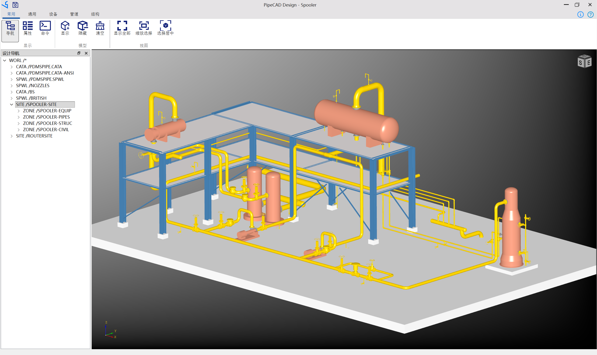
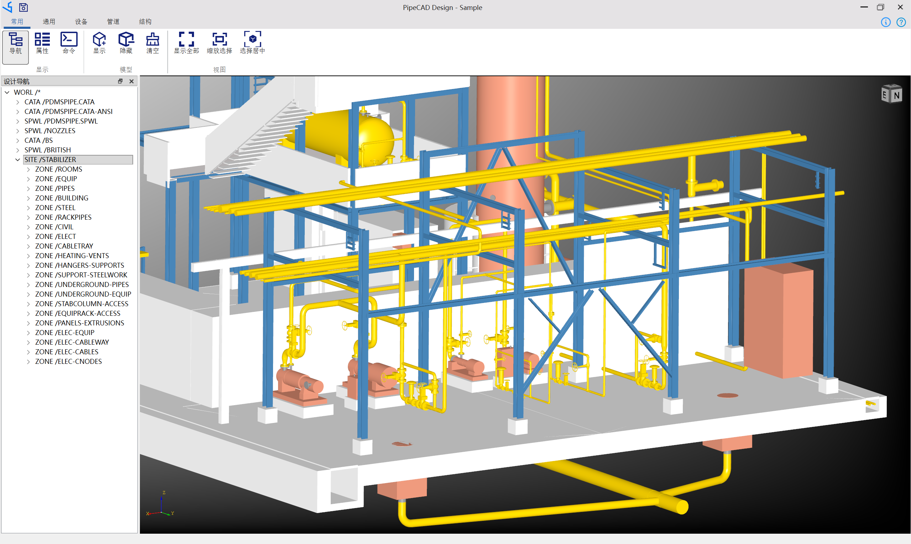
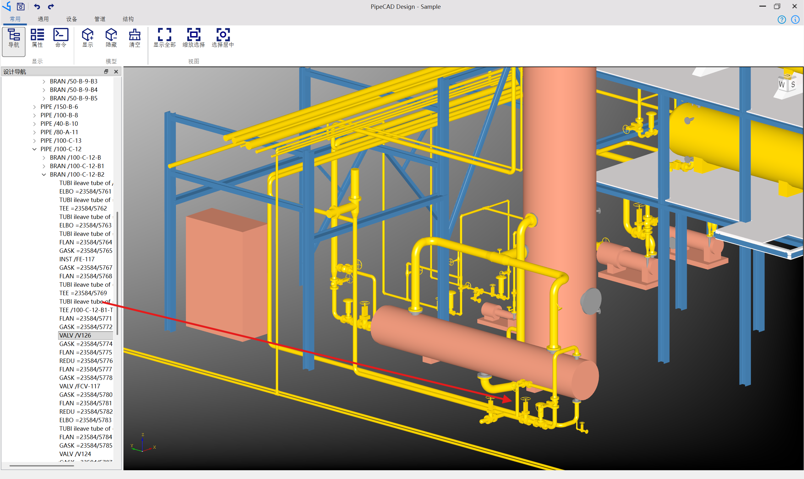
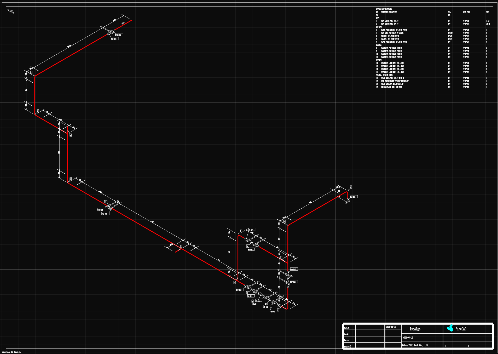

## PipeCAD - Plant Piping Design Software.

| PipeCAD | **Free Edition** | **Professional Edition** |
| :--- | :--- | :--- |
| Design Modeling | :heavy_check_mark: | :heavy_check_mark:   |
| Export Piping PCF | :heavy_check_mark: | :heavy_check_mark:   |
| Export Review RVM | :heavy_check_mark: | :heavy_check_mark:   |
| Export MTO | :warning: BASIC | :heavy_check_mark: |
| Piping Isometrics Drawing | :warning: BASIC | :heavy_check_mark: |
| Piping Arrangement Drawing | :warning: BASIC | :heavy_check_mark: |
| Nozzle Orientation Drawing | :warning: BASIC | :heavy_check_mark: |

PipeCAD Free Edition is **FREE** to personal, commercial or enterprise use.

PipeCAD Professional Edition is **NOT FREE**, you can send email consult to buy it.

### Python Plugins
PipeCAD provide customization by Python. The python plugins locate in the python/PipeCAD folder.
The Python plugins are open source with **MIT** license.

## PipeCAD Sample

Spooler project:

Stabilizer project:

## Piping Isometrics

PipeCAD generate piping isometric drawing by IsoAlgo:

